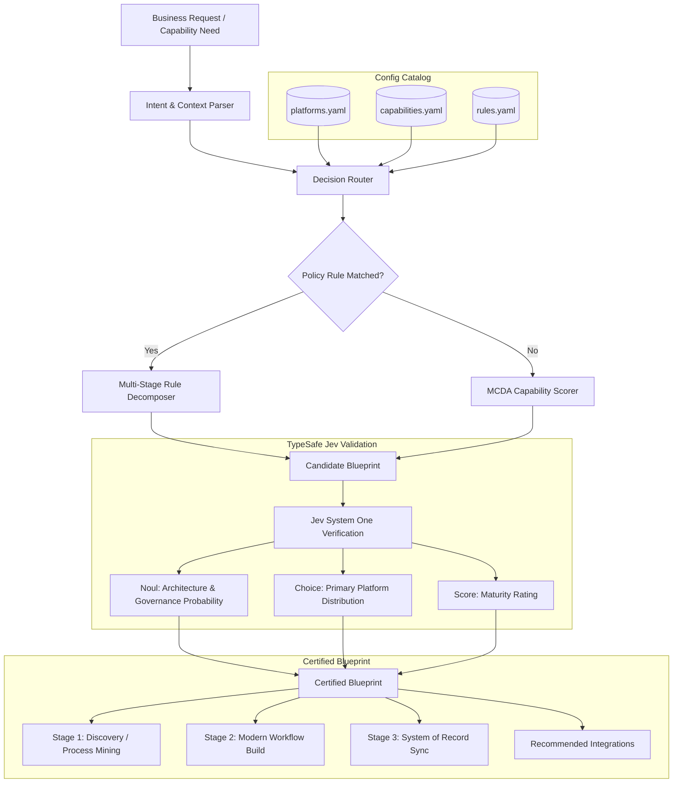

# Enterprise Platform Decision Engine (`platform-decision-engine`)

[](https://www.python.org/)
[](https://fastapi.tiangolo.com)
[](https://pydantic.dev)
[]()

An intelligent, rule- and scoring-driven **Enterprise Architecture Decision Engine** that dynamically evaluates business capability initiatives and determines the optimal platform routing and multi-platform orchestration blueprints.

---

## 🏛️ Core Architecture & Concept

Enterprise IT environments comprise distinct architectural tiers:
- **Systems of Record (SoR)**: Authoritative sources for master data and compliance (e.g., HRIS, Payroll, CRM Data Core).
- **Systems of Engagement (SoE)**: Agile, omnichannel low-code / digital process automation layers for tailored employee and customer experiences.
- **Systems of Intelligence (SoI)**: Analytical, process mining, and AI engines that identify bottlenecks and optimize flows.

The **Platform Decision Engine** bridges business intent and platform capabilities by executing:
1. **Rule-Based Decomposition**: Matches high-priority architecture policies and decomposes complex requirements into multi-platform lifecycle stages.
2. **Multi-Criteria Decision Analysis (MCDA)**: Fallback scoring engine factoring capability fit, tier suitability, and feature requirements.
3. **Integration Derivation**: Automatically recommends event/API integration bridges between selected systems.



### 🧠 How Platform Capabilities & Constraints are Sent to Jev

The engine passes the full platform capability matrix ([`config/platforms.yaml`](config/platforms.yaml:1)), constraints, and candidate stages directly to Jev inside the System One `state` payload:

1. **State Serialization**:
   - `available_platforms_catalog`: Full catalog of platforms, their architectural tiers, capabilities with strength scores and features, and governance constraints.
   - `candidate_blueprint_stages`: Proposed execution stages (e.g. Discovery on Green $\rightarrow$ Build on Purple $\rightarrow$ Sync on Green).
2. **Typed Judgments Evaluated**:
   - **`primary_platform_fit` (`choice`)**: Choice primitive over all catalog platforms with dynamically built criteria.
   - **`is_valid_architecture` (`noul`)**: Probability ($0.0 - 1.0$) that the blueprint adheres to decoupled architecture principles without violating constraints.
   - **`is_governance_compliant` (`noul`)**: Probability ($0.0 - 1.0$) that master data sovereignty is preserved.
   - **`architecture_alignment_score` (`score`)**: Rates overall maturity on a 0–3 descriptive level scale.

---

## 🎯 Supported Enterprise Scenarios

| Scenario | Domain & Capability | Strategic Intent | Target Platform(s) & Flow |
| :--- | :--- | :--- | :--- |
| **Optimize Existing Onboarding** | `HR` / `hr.onboarding` | `optimize_existing` | **Stage 1**: Process Mining on **Green Platform**<br>**Stage 2**: Streamlined Workflow Build on **Purple Platform**<br>**Stage 3**: Master Record Sync to **Green Platform** |
| **Build New Onboarding** | `HR` / `hr.onboarding` | `build_new` | **Stage 1**: Experience & Portal Build on **Purple Platform**<br>**Stage 2**: Master Profile Ingestion to **Green Platform** |
| **New CRM Process** | `CRM` / `crm.process` | `build_new` | **Stage 1**: Configure Sales Pipeline on **Blue Platform** |
| **Update Payroll Rules** | `FINANCE` / `finance.payroll` | `update_core_process` | **Stage 1**: Statutory Tax & Pay Formula Update on **Dark Blue Platform** |

---

## 📁 Repository Structure

```text
platform-decision-engine/
├── config/
│   ├── platforms.yaml          # Enterprise platform profiles, tiers, strengths & constraints
│   ├── capabilities.yaml       # Hierarchical enterprise capability taxonomy
│   └── rules.yaml              # Architecture rules & multi-stage decomposition policies
├── src/
│   ├── models/                 # Pydantic schemas (Platform, Capability, Request, Blueprint)
│   ├── engine/
│   │   ├── catalog.py          # YAML Catalog loader and validator
│   │   ├── rule_evaluator.py   # Rule matching & condition evaluation
│   │   ├── scorer.py           # Multi-Criteria Decision Analysis (MCDA) scoring
│   │   └── router.py           # Decision engine & multi-stage orchestration planner
│   ├── api/                    # FastAPI REST API (endpoints for /decide, /platforms, /rules)
│   ├── cli.py                  # Rich interactive CLI
│   └── main.py                 # Application entrypoint
├── examples/                   # Sample JSON requests & runner script
├── tests/                      # Pytest automated test suite
├── requirements.txt
└── pyproject.toml
```

---

## 🚀 Quickstart

### 1. Installation

```bash
git clone https://github.com/anilvaranasi/platform-decision-engine.git
cd platform-decision-engine
git checkout mydev

# Install dependencies
pip install -r requirements.txt
```

### 2. Run the Interactive CLI

#### Demo all primary scenarios:
```bash
python src/cli.py demo
```

#### Run an ad-hoc decision query:
```bash
# Optimize existing HR onboarding
python src/cli.py decide --domain HR --capability hr.onboarding --intent optimize_existing

# Build new CRM process
python src/cli.py decide --domain CRM --capability crm.process --intent build_new

# Update statutory payroll
python src/cli.py decide --domain FINANCE --capability finance.payroll --intent update_core_process
```

#### View registered platform catalog & architecture rules:
```bash
python src/cli.py list-platforms
python src/cli.py list-rules
```

---

### 3. Test via Localhost REST API & Swagger UI

#### Step 1: Start the Local API Server
Run the FastAPI application locally:
```powershell
python src/main.py serve 8000
```
*The server will start on `http://127.0.0.1:8000` with hot-reload enabled.*

#### Step 2: Open Interactive Swagger UI
Open your browser to:
👉 **[http://localhost:8000/docs](http://localhost:8000/docs)** (or ReDoc at [http://localhost:8000/redoc](http://localhost:8000/redoc))

#### Step 3: Test Endpoints Locally

##### A. Test Health Check (`GET /health`)
```powershell
# PowerShell
Invoke-RestMethod -Uri "http://localhost:8000/health" -Method Get
```
```bash
# cURL
curl http://localhost:8000/health
```

##### B. Test Decision Routing with Jev Validation (`POST /decide`)

**1. Optimize Existing HR Onboarding:**
```powershell
# PowerShell
$body = @{
    initiative_name = "Optimize Existing HR Onboarding"
    domain = "HR"
    capability = "hr.onboarding"
    intent = "optimize_existing"
    description = "Process mining on legacy HR and streamline flow in purple platform"
} | ConvertTo-Json

Invoke-RestMethod -Uri "http://localhost:8000/decide" -Method Post -Body $body -ContentType "application/json"
```

```bash
# cURL
curl -X POST http://localhost:8000/decide \
  -H "Content-Type: application/json" \
  -d '{
    "initiative_name": "Optimize Existing HR Onboarding",
    "domain": "HR",
    "capability": "hr.onboarding",
    "intent": "optimize_existing"
  }'
```

**2. Build New CRM Process:**
```powershell
$body = @{
    initiative_name = "New CRM Sales Funnel"
    domain = "CRM"
    capability = "crm.process"
    intent = "build_new"
} | ConvertTo-Json

Invoke-RestMethod -Uri "http://localhost:8000/decide" -Method Post -Body $body -ContentType "application/json"
```

##### C. Inspect Platform Catalog & Architecture Rules
```powershell
# Get all platforms
Invoke-RestMethod -Uri "http://localhost:8000/platforms" -Method Get

# Get all rules
Invoke-RestMethod -Uri "http://localhost:8000/rules" -Method Get
```

---

## 🧪 Automated Testing

Run the full automated test suite covering all routing rules, scoring, and Jev validation:
```powershell
python -m pytest -v
```

---

## ⚙️ Configuration & Customization

All platform definitions, capability matrices, and architecture policies are declaratively managed in `config/`:

- **Add a New Platform**: Edit `config/platforms.yaml` to declare vendor tier, capability strength scores (0.0 to 1.0), and governance constraints.
- **Add Rules**: Edit `config/rules.yaml` to define decomposition conditions (domain, capability pattern, intent) and target execution stages.
