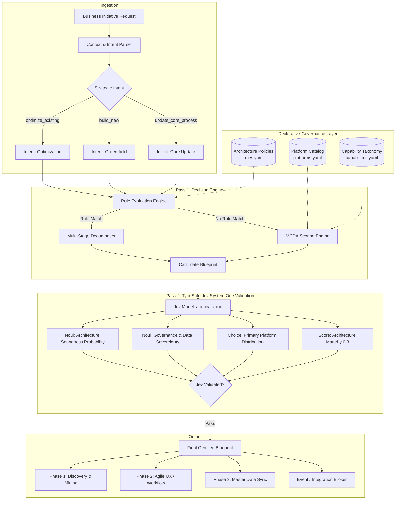

# 🏛️ Enterprise Architecture: Platform Decision Engine (PDE)

**Author:** Architecture & Platform Strategy COE  
**Target Audience:** Enterprise Architects, Domain Leads, Engineering Leaders, Product Managers  
**Status:** Approved / Active Reference Architecture  
**Repository:** `https://github.com/anilvaranasi/platform-decision-engine` (Branch: `mydev`)  

---

## 1. Executive Summary

As enterprise IT ecosystems expand, teams frequently face fragmented decision-making when selecting platforms for new capabilities or process modernizations. Building bespoke workflows directly into legacy Systems of Record causes technical debt and UI rigidity, while building unregulated custom apps creates shadow data silos.

The **Platform Decision Engine (PDE)** establishes a unified, policy-driven decision maker that dynamically routes enterprise capabilities to the optimal target platform and generates end-to-end, multi-stage orchestration blueprints.

### Key Highlights
- **Decoupled Three-Tier Model**: Separates Systems of Engagement (SoE), Systems of Record (SoR), and Systems of Intelligence (SoI).
- **Multi-Stage Orchestration**: Rather than forcing a single platform per initiative, PDE composes multi-phase journeys (e.g., *Discover in System A → Build in System B → Sync to System C*).
- **Dual Evaluation Engine**: Combines deterministic Enterprise Architecture rules (prioritized policies) with Multi-Criteria Decision Analysis (MCDA) scoring for fallback coverage.
- **Developer & Operator Interfaces**: Fully accessible via CLI, declarative YAML catalogs, and OpenAPI-compliant REST services.

---

## 2. Problem Statement & Motivation

| Traditional Anti-Pattern | Business Impact | PDE Architectural Solution |
| :--- | :--- | :--- |
| **Monolithic Customization** (e.g., building customized employee portals directly inside legacy Core HR) | Rigid UI, slow release cycles, expensive vendor lock-in. | **Engagement Decoupling**: Build modern UX in agile Low-Code/DPA platforms (*Purple*), leaving master data in Core HR (*Green*). |
| **Disjointed Modernization** (Guessing where process optimization belongs) | Lack of data-backed process discovery; rebuilding inefficient flows. | **Intelligence-First Flow**: Extract friction using native Process Mining (*Green*) before building redesigned flows (*Purple*). |
| **Siloed Domain Sprawl** (Building CRM or Payroll logic across ad-hoc tools) | Statutory compliance violations, fragmented customer views. | **Domain Specialist Routing**: Direct customer journeys to CRM (*Blue*) and statutory compliance to Payroll (*Dark Blue*). |

---

## 3. Reference Architecture & Decision Pipeline (Dual-Pass with Jev System One)

The architecture employs a **two-pass generation and validation pattern**:
1. **Pass 1 (Deterministic Generation)**: The engine parses intent and catalog policies to decompose the request into multi-platform execution stages.
2. **Pass 2 (TypeSafe Jev System One Validation)**: The generated blueprint is validated by **Jev** using typed primitives (`noul` for governance compliance, `choice` for primary fit, and `score` for architectural maturity).



---

### 3.1 How Platform Capabilities & Constraints are Sent to Jev

To provide Jev with complete architectural context, the engine packages the full platform catalog (`platforms.yaml`) into the System One `state` payload and formulates typed decision primitives (`noul`, `choice`, `score`):

#### A. Structured `state` Payload
```json
{
  "state": {
    "initiative": "Optimize Existing HR Onboarding Process",
    "request": {
      "domain": "HR",
      "capability": "hr.onboarding",
      "intent": "optimize_existing"
    },
    "available_platforms_catalog": {
      "green_platform": {
        "name": "Green Platform",
        "tier": "System of Record & Intelligence",
        "capabilities": [
          "hr.master_data (strength: 0.98, features: employee_profile, org_hierarchy, audit_log)",
          "hr.onboarding.process_mining (strength: 0.92, features: event_log_ingestion, bottleneck_detection)",
          "hr.onboarding.workflow (strength: 0.45, features: rigid_checklists)"
        ],
        "constraints": [
          "Do not build custom multi-tier employee portal frontends here due to rigid UI customization limits",
          "Authoritative source of record for employee demographics and organizational hierarchy"
        ]
      },
      "purple_platform": {
        "name": "Purple Platform",
        "tier": "System of Engagement & Orchestration",
        "capabilities": [
          "hr.onboarding.workflow (strength: 0.96, features: omnichannel_ux, drag_and_drop_forms, e_signature)",
          "workflow.custom_app (strength: 0.95, features: custom_ui, mobile_ready)"
        ],
        "constraints": [
          "Must not store master employee records long-term (ephemeral task state only)",
          "Must push finalized transactions to respective Systems of Record"
        ]
      },
      "blue_platform": { "name": "Blue Platform (CRM)", "tier": "Domain System of Record & Engagement", "capabilities": ["crm.process", "crm.pipeline"] },
      "dark_blue_platform": { "name": "Dark Blue Platform (Payroll)", "tier": "System of Record (Payroll)", "capabilities": ["finance.payroll"] }
    },
    "candidate_blueprint_stages": [
      { "stage_number": 1, "platform_id": "green_platform", "action": "Extract HR event logs & run Process Mining..." },
      { "stage_number": 2, "platform_id": "purple_platform", "action": "Model & deploy streamlined journey in low-code..." },
      { "stage_number": 3, "platform_id": "green_platform", "action": "Sync finalized employee master record..." }
    ]
  }
}
```

#### B. Typed Primitives Formulated for Jev
1. **`primary_platform_fit` (`choice`)**:
   Dynamically binds all catalog platforms into candidate choices to verify the primary build target.
2. **`is_valid_architecture` (`noul`)**:
   Evaluates probability ($0.0 - 1.0$) that the multi-platform allocation satisfies decoupling without violating constraints.
3. **`is_governance_compliant` (`noul`)**:
   Evaluates probability ($0.0 - 1.0$) that master data sovereignty is preserved.
4. **`architecture_alignment_score` (`score`)**:
   Rates maturity on a 4-level descriptive scale (Level 0 Monolithic $\rightarrow$ Level 3 Optimal Composable).

#### C. Live Jev Output
```text
• Architecture Soundness (Noul)     : 90.0% Compliant
• Data Governance (Noul)            : 94.0% Compliant
• Primary Platform Fit (Choice)     : purple_platform (100.0% Confidence)
• Alignment Maturity (Score 0–3)    : 2.99 / 3.0 (100.0% Confidence)
```

---

## 4. Platform Tiering & Archetypes

The reference configuration classifies enterprise platforms into clear architectural roles:

```mermaid
quadrantChart
    title Enterprise Platform Positioning Matrix
    x-axis Low Customization Agility --> High Customization Agility
    y-axis Operational System of Record --> Omnichannel Engagement & Intelligence
    quadrant-1 Modern Low-Code Orchestration (Purple Platform)
    quadrant-2 Systems of Intelligence & Mining (Green Platform Analytics)
    quadrant-3 Core Systems of Record (Green HR, Dark Blue Payroll)
    quadrant-4 Domain Core & CRM (Blue Platform)
    "Purple Platform (DPA/Low-Code)": [0.88, 0.85]
    "Green Platform (Core HR)": [0.20, 0.25]
    "Green Platform (Process Mining)": [0.35, 0.70]
    "Blue Platform (CRM)": [0.70, 0.50]
    "Dark Blue Platform (Payroll)": [0.15, 0.20]
```

### Registered Platform Profiles

1. **Purple Platform (System of Engagement & Orchestration)**:
   - *Role*: High-productivity low-code, dynamic forms, omnichannel portals, approval workflows.
   - *Constraint*: Ephemeral task state only; must not act as permanent System of Record for master data.

2. **Green Platform (System of Record & Process Intelligence)**:
   - *Role*: Authoritative employee master data, organizational hierarchy, historical transactional logs, embedded process mining.
   - *Constraint*: Do not build multi-tier bespoke frontend portals due to UI rigidity.

3. **Blue Platform (Domain System of Record & Engagement - CRM)**:
   - *Role*: Enterprise customer relationship management, lead-to-opportunity pipeline, customer accounts.

4. **Dark Blue Platform (System of Record - Payroll & Compliance)**:
   - *Role*: Statutory gross-to-net tax rules, direct deposit, regulatory filings.
   - *Constraint*: Strictly controlled; dedicated to payroll execution and compliance.

---

## 5. Walkthrough of Benchmark Scenarios

### Scenario A: Optimize Existing Onboarding Journey
- **Business Request**: *"Our existing onboarding has long cycle times and drop-offs. We want to streamline it."*
- **Generated Blueprint**:
  1. **Phase 1 (Discovery)**: Run Process Mining in **Green Platform** to pinpoint friction and approval bottlenecks.
  2. **Phase 2 (Build)**: Build streamlined onboarding experience and digital tasks in **Purple Platform**.
  3. **Phase 3 (Sync)**: Synchronize finalized employee profiles back to **Green Platform** via asynchronous webhooks/Kafka.

### Scenario B: Green-field Employee Onboarding
- **Business Request**: *"Build a new onboarding portal for new hires."*
- **Generated Blueprint**:
  1. **Phase 1 (Build)**: Construct responsive portal and task checklists in **Purple Platform**.
  2. **Phase 2 (Sync)**: Feed completed hire data automatically into **Green Platform**.

### Scenario C: CRM Capability Build
- **Business Request**: *"Implement new sales opportunity pipeline and account management."*
- **Generated Blueprint**:
  1. **Phase 1 (Configure)**: Implemented directly in **Blue Platform** using native CRM objects and pipeline automations.

### Scenario D: Payroll Engine Update
- **Business Request**: *"Update tax withholding formulas for statutory compliance."*
- **Generated Blueprint**:
  1. **Phase 1 (Update)**: Execute changes within **Dark Blue Platform** payroll engine.

---

## 6. How Teams Can Consume the Decision Engine

### A. Terminal CLI (For Architects & Engineers)
```bash
# Interactive evaluation
python src/cli.py decide --domain HR --capability hr.onboarding --intent optimize_existing

# Run all reference scenario demos
python src/cli.py demo
```

### B. REST API & Localhost Testing (Swagger UI)
1. **Start the API Server**:
   ```powershell
   python src/main.py serve 8000
   ```
2. **Access Interactive Docs**:
   - Swagger UI: `http://localhost:8000/docs`
   - ReDoc: `http://localhost:8000/redoc`

3. **Execute Decisions via REST**:
   ```powershell
   $body = @{
       initiative_name = "Revamp Employee Onboarding"
       domain = "HR"
       capability = "hr.onboarding"
       intent = "optimize_existing"
   } | ConvertTo-Json

   Invoke-RestMethod -Uri "http://localhost:8000/decide" -Method Post -Body $body -ContentType "application/json"
   ```

### C. Declarative Customization (GitOps)
Teams can extend the engine by updating YAML files under `config/`:
- Add new platforms in [`config/platforms.yaml`](config/platforms.yaml)
- Extend domains in [`config/capabilities.yaml`](config/capabilities.yaml)
- Introduce architectural policies in [`config/rules.yaml`](config/rules.yaml)

---

## 7. Next-Phase Roadmap

1. **LLM Natural Language Intent Extraction**: Integrate watsonx / LLM agents to convert raw project PRDs or Jira initiatives directly into `RequestContext` schemas.
2. **Enterprise Service Catalog Sync**: Automatically ingest active platforms and APIs from ServiceNow / Backstage.
3. **Automated Scaffolding**: Generate starter repositories, OpenAPI contracts, and Kafka schema bindings directly from the generated `DecisionBlueprint`.
